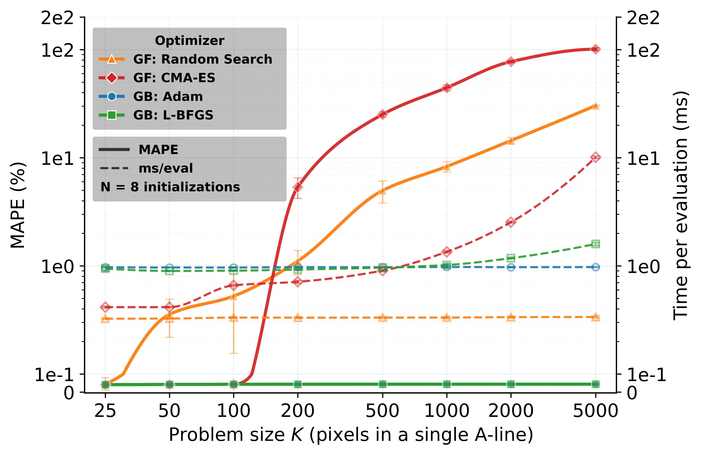
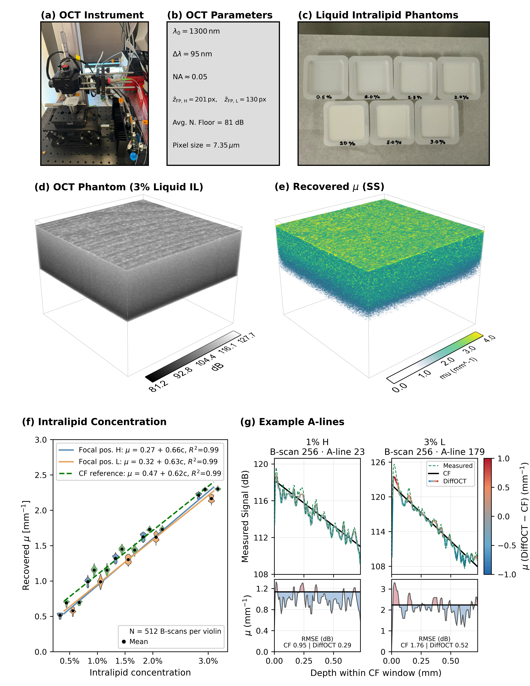

# <p align="center">DiffOCT: Differentiable Inverse Rendering Recovers Intrinsic Properties from Intravascular OCT</p>

<div align="center">

  [](https://www.python.org/)
  [](https://pytorch.org/)
  [](LICENSE)
  [](https://doi.org/10.5281/zenodo.24113082)

</div>
<br>
<p align="center">
  
</p>

## Abstract

Medical images encode intrinsic tissue properties which indicate disease progression. Yet, these properties remain entangled with the system-dependent physics of image formation making them challenging to recover. A central question in differentiable inverse rendering is whether such properties can be recovered directly from an image by inverting the imaging system's forward physics rather than through post-hoc corrections. We address this question in optical coherence tomography (OCT), focusing on the optical attenuation coefficient (OAC), a per-pixel property indicative of pathology and cellular composition. Conventional OAC recovery relies on closed-form inversions limited to simplified light-tissue models, or on learned methods coupled to specific imaging configurations. We instead recover per-pixel attenuation from a single OCT image by gradient descent through a differentiable physics-based forward model, yielding parameters with direct physical interpretation. We verified the method against analytical solutions, validated it on five in vitro phantoms, and applied it without modification to 29,269 clinical coronary intravascular OCT (IV-OCT) images over a cohort of 128 patients. Because the inversion rests on image-formation physics, it is portable across platforms and applicable to retrospective clinical archives without requiring training data, segmentations, or fixed analytical assumptions. Recovering a parameter at every pixel is only tractable because gradient information scales to the high-dimensional inverse problem, where gradient-free methods become intractable. More broadly, our work supports differentiable inverse rendering as a scalable route toward physics-grounded quantitative imaging in digital health.

## Highlights

1. Differentiable physics-based forward model for OCT (single-scatter Beer-Lambert and multiple-scatter Extended Huygens-Fresnel) implemented end-to-end in PyTorch.
2. Per-pixel optical attenuation (μ) and backscattering fraction (α) recovered from a single B-scan via Adam gradient descent, with no training data, segmentations, or fixed analytical assumptions.
3. Verified analytically against Beer-Lambert (R² = 1.0000), validated on Intralipid phantoms, and applied without modification to 29,269 frames over a 128-patient IV-OCT cohort.

**Authors.** Ajay Manicka, Karim Kadry, Sebastián Ruiz-Lopera, Maryam Alsharqi, Sanjana Arji, Samuel Ruipérez-Campillo, Néstor Uribe-Patarroyo, Brett E. Bouma, Farhad Nezami, Elazer R. Edelman.
**Correspondence.** [ajay_m@mit.edu](mailto:ajay_m@mit.edu)

## Setup

```bash
git clone https://github.com/Ajay-M-create/DiffOCT
cd DiffOCT
conda env create -f setup/environment.yml
conda activate diff-oct
python -c "import torch; print('CUDA:', torch.cuda.is_available())"
```

The figure notebooks also need `pdflatex` on `PATH` (Figure 4 typesets its tables). Full instructions, including cluster SLURM templates and the expected data layout, are in [`setup/install.md`](setup/install.md).

## Quick Start

The forward model is a standard `torch.nn.Module`. Gradients of any reconstruction loss flow back to the per-pixel attenuation map. Run from the repository root.

```python
import os
import torch
from omegaconf import OmegaConf
from src.forward import create_forward_model
from src.inverse import optimize

config = OmegaConf.load("configs/config.yaml")                      # OCT system + forward model
opt_config = OmegaConf.load("configs/optimization_config_fast.yaml")
device = torch.device("cuda")

forward = create_forward_model(config, device=device)               # SS Beer-Lambert (or MS EHF)

H = config.forward_model_system.depth_samples                       # 500
W = config.forward_model_system.a_lines                             # 500
mu = torch.nn.Parameter(torch.full((H, W), 5.0, device=device))     # mm^-1, learnable
alpha = torch.nn.Parameter(torch.ones((H, W), device=device))       # backscattering fraction

# Forward pass: predicted B-scan in dB, fully differentiable w.r.t. mu and alpha
I_pred_dB = forward(mu, alpha)                                      # (H, W) tensor in dB
I_target_dB = torch.zeros_like(I_pred_dB)                           # replace with a real B-scan in dB
loss = torch.nn.functional.mse_loss(I_pred_dB, I_target_dB)
loss.backward()
print(mu.grad.shape)                                                # torch.Size([500, 500])

# Full Adam loop (cosine LR, noise-floor masking, projection, best-model restoration)
mu = torch.nn.Parameter(torch.full((H, W), 5.0, device=device))
alpha = torch.nn.Parameter(torch.ones((H, W), device=device))
out_dir = "outputs/quickstart"
os.makedirs(out_dir, exist_ok=True)
mu_best, alpha_best, metrics, *_ = optimize(
    forward, mu, alpha, I_target_dB, opt_config,
    prune_threshold=opt_config.optimization.mu_min_mm_inv,
    device=device, out_dir=out_dir,
    recompute_gain_mse_optimal_each_iter=True,
)
```

## Reproducing the Paper Figures

Figures 1 to 4 each have a notebook in [`figures/`](figures/) that reads cached arrays from `figures/data/` and writes `figures/output/figureN.{pdf,jpeg,svg}`. All four run from a fresh clone without re-running any optimization. Figure 5 is built from clinical data that cannot be shared, so only the rendered figure is included. Source data for every main figure is in [`figures/output/Supplementary_Data_1_Source_Data.xlsx`](figures/output/Supplementary_Data_1_Source_Data.xlsx).

| Figure | Notebook | Cached data | Runtime |
|---|---|---|---|
| 1, single-A-line optimizer scaling | [figure1_single_aline_scaling.ipynb](figures/figure1_single_aline_scaling.ipynb) | `figure1_single_aline_scaling/` | ~5 s |
| 2, forward and inverse verification | [figure2_verification.ipynb](figures/figure2_verification.ipynb) | `figure2_verification/` | ~15 s |
| 3, liquid Intralipid phantom validation | [figure3_liquid_phantom.ipynb](figures/figure3_liquid_phantom.ipynb) | `figure3_liquid_phantom/` | ~10 s |
| 4, identifiability and noise robustness | [figure4_identifiability_robustness.ipynb](figures/figure4_identifiability_robustness.ipynb) | `figure4_identifiability_robustness/` | ~15 s |
| 5, clinical IV-OCT μ and α | Rendered figure only (`figures/output/figure5.*`) | Restricted clinical data | n/a |
| 6, framework overview | Externally drawn diagram | n/a | n/a |

Runtimes are measured on a workstation with an RTX A6000. To execute every notebook headlessly:

```bash
cd figures
for nb in figure*.ipynb; do jupyter nbconvert --to notebook --execute --inplace "$nb"; done
```

### Figure 1, single-A-line optimizer scaling



Problem size K counts attenuation parameters within one synthetic A-line, from 25 to 5000, while physical tissue thickness stays at 0.16 mm. Solid curves show ground-truth attenuation MAPE and dashed curves show time per objective evaluation for two gradient-free (GF: Random Search, CMA-ES) and two gradient-based (GB: Adam, L-BFGS) optimizers. At K = 5000, Adam and L-BFGS reach about 0.044% MAPE, compared with 30.32% for Random Search and 100.91% for CMA-ES across eight initializations.

### Figure 2, forward and inverse model verification


Panels a to i validate the differentiable forward model against analytical Beer-Lambert solutions on 2-, 3-, and 4-layer configurations (R² = 1.0000, MAE = 5.1 × 10⁻⁷ dB across a representative B-scan). Panels j to t show the inverse problem on 500 synthetic phantoms, converging from scrambled initialization (R² = 0.0001, MAPE = 79.6%) to near-perfect recovery (R² = 0.9996, MAPE = 0.15%) over 30,000 iterations.

### Figure 3, liquid Intralipid phantom validation



Panels a to c show the OCT system, its parameters, and the liquid Intralipid phantoms. Panels d and e render the measured dB volume and the recovered μ volume for a 3% phantom. Panel f compares recovered attenuation across Intralipid concentrations, and panel g overlays two example A-lines with the conventional curve-fitting (CF) line and the DiffOCT prediction. The 3D renders are stored as lossless embedded PDFs; re-rendering them from raw volumes uses `experiments/REBUTTAL_liquid_intralipid_cf_comparison/render_3d_liquid.py`.

### Figure 4, identifiability and noise robustness


Across 20 random initializations per acquisition, intra-acquisition coefficients of variation ranged from 0.18% to 0.32%. Across 10 initialization range conditions, 7 fell into a stable convergence region. Under controlled SNR injection, degradation remained marginal over the first 4 to 5 dB of added noise below each phantom's baseline SNR and diverged sharply below.

### Figure 5, clinical IV-OCT attenuation and backscattering fraction


The framework was applied without modification to all 29,269 frames over 128 patients. Stage 1 (μ only) reproduces target geometry with Dice = 0.957 ± 0.007 at the 15 dB noise floor and PSNR = 14.83 ± 0.99 dB. Optimizing α with μ frozen (Stage 2) raises cohort-wide PSNR to 22.63 ± 0.74 dB (Dice = 0.954 ± 0.009). The clinical data are restricted by a data use agreement and are not included; the figure is provided as rendered.

## Reproducing the Experiments

Each experiment script writes raw per-frame artifacts to `outputs/{experiment}/` (gitignored) and stages the subset each figure needs into `figures/data/`. Running them requires the raw phantom acquisitions (`inputs/`, see [`setup/install.md`](setup/install.md)), which are not included here.

```
experiments/X.py  ── runs ──▶  outputs/X/                (raw, gitignored)
                                   └── stage ──▶  figures/data/figureN_*/   (tracked)
                                                      └── read by ──▶  figures/figureN_*.ipynb
                                                                          └── writes ──▶  figures/output/figureN.*
```

| Figure | Experiment | Launcher |
|---|---|---|
| 1 | `experiments/REBUTTAL_single_aline_scaling.py` | `scripts/run_REBUTTAL_single_aline_scaling.sh` |
| 2 | `experiments/forward_model_verification.py`, `experiments/inverse_model_verification.py` | `scripts/run_forward_model_verification.sh`, `scripts/run_inverse_model_verification.sh` |
| 3 | `experiments/REBUTTAL_liquid_intralipid_cf_comparison/production.py` | `scripts/run_REBUTTAL_liquid_intralipid_production.sh` |
| 4 | `experiments/identifiability_study.py`, `experiments/robustness_study.py` | `scripts/run_identifiability_study.sh`, `scripts/run_robustness_study.sh` |
| 5 | `experiments/generate_patient_oac.py`, `experiments/all_pre_ivl_render_psnr.py` | `scripts/run_showcase_patient_frames.sh`, `scripts/run_all_pre_ivl_render_psnr.sh` |

```bash
# Figure 2
python experiments/forward_model_verification.py
python experiments/inverse_model_verification.py              # 500 synthetic phantoms
SUMMARIZE=1 python experiments/inverse_model_verification.py

# Figure 4
PHASE=1 python experiments/identifiability_study.py            # seed sweep
PHASE=2 python experiments/identifiability_study.py            # initialization range sweep
SUMMARIZE=1 PHASE=1 python experiments/identifiability_study.py
python experiments/robustness_study.py
SUMMARIZE=1 python experiments/robustness_study.py

# Figure 5 (requires your own IV-OCT volumes)
PATIENT_ID=<id> python experiments/generate_patient_oac.py
```

The `scripts/run_*.sh` launchers target the MIT SuperCloud SLURM cluster; edit the interpreter path and partition names in each launcher for your system.

### Supplementary experiments

Code for the supplementary analyses is included so that every reported number can be regenerated: optimizer scaling on B-scans and measured A-lines (`experiments/optimizer_scaling.py`, `experiments/REBUTTAL_single_liquid_IL_aline/`), parameter and hyperparameter sensitivity (`experiments/supp_parameter_ablation.py`), single versus multiple scattering (`experiments/supp_ehf.py`, `experiments/REBUTTAL_ms_parameter_sensitivity/`), hardware benchmarks (`experiments/hardware_benchmark.py`), forward-model mismatch (`experiments/REBUTTAL_model_mismatch/`), clinical initialization uncertainty (`experiments/REBUTTAL_clinical_init_uncertainty/`), and joint confocal estimation (`experiments/optimize_confocal.py`). The supplementary figures themselves are published with the paper; their rendering notebooks and cached data are not part of this repository.

## Repository Structure

```
src/                                  Library code
├── forward.py                        SS Beer-Lambert + MS Extended Huygens-Fresnel forward models
├── inverse.py                        Adam loop, masked dB-MSE loss, noise-floor subtraction
├── roi.py                            Surface detection and IntMask tissue-mask loading
├── helpers.py                        Shared utilities
└── visualization.py                  Plotting and 3D volume rendering helpers

experiments/                          Data-generating scripts (main and supplementary)
scripts/                              SLURM launchers and the source-data workbook builder
figures/
├── figure{1..4}_*.ipynb              Main-figure notebooks
├── data/figure{1..4}_*/              Cached arrays per figure
└── output/                           Rendered figures and source-data workbook
configs/                              YAML configs (system, optimizer, scatterer, phantom ROI)
matlab_CF_scripts_results/IntMask.mat Tissue mask from the conventional curve-fitting pipeline
test-shockwave-arteries/              Batched GPU optimizer used by the clinical cohort script
setup/                                environment.yml, install.md
```

## Data Format

OCT phantom acquisitions are 16-bit TIFF stacks (512 B-scans per file, 500 × 500 pixels) stored in log-intensity scale: `dB = raw × (130/65535)`, giving 0 to 130 dB. Data stays in dB throughout the pipeline.

Clinical IV-OCT volumes follow the format described in the paper Methods (NIfTI-converted pullbacks in polar coordinates, two-stage μ + α optimization). Clinical data are not redistributed.

Tissue μ is reported inside the `IntMask.mat` tissue mask. All-pixel averages include zeroed noise-floor pixels and underestimate tissue μ by about 30%.

## Citation

The code is archived on Zenodo. If you use it, please cite the archived release:

```bibtex
@software{manicka_diffoct_2026,
  author    = {Manicka, Ajay and Kadry, Karim and Ruiz-Lopera, Sebasti{\'a}n and
               Alsharqi, Maryam and Arji, Sanjana and Ruip{\'e}rez-Campillo, Samuel and
               Uribe-Patarroyo, N{\'e}stor and Bouma, Brett E. and Nezami, Farhad and
               Edelman, Elazer R.},
  title     = {{DiffOCT: Differentiable Inverse Rendering Recovers Intrinsic Properties
               from Intravascular OCT}},
  year      = {2026},
  publisher = {Zenodo},
  version   = {v1.0.1},
  doi       = {10.5281/zenodo.24114042},
  url       = {https://doi.org/10.5281/zenodo.24114042}
}
```

`10.5281/zenodo.24114042` identifies this exact version (v1.0.1); `10.5281/zenodo.24113082` always resolves to the latest release.

## License

The code is released under the [MIT License](LICENSE).
